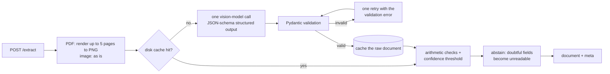

# Document extraction

An API that reads Indonesian receipts and invoices (photos or PDFs) and returns
typed JSON where every field carries a status and a confidence, plus a
separate harness that scores the API against hand-labelled ground truth.

## Run

1. Copy the example settings and fill in your provider (any OpenAI-compatible
   endpoint with a vision model):

   ```
   cp .env.example .env
   ```

   Set `LLM_BASE_URL`, `LLM_API_KEY` and `LLM_MODEL`. `.env` is never committed
   and never copied into the image. The values used for the committed results
   (OpenRouter):

   ```
   LLM_BASE_URL=https://openrouter.ai/api/v1
   LLM_API_KEY=<your OpenRouter key>
   LLM_MODEL=google/gemini-2.5-flash
   LLM_CACHE=1
   LLM_REASONING_EFFORT=
   EVAL_CONCURRENCY=3
   PRICE_INPUT_PER_M=0.30
   PRICE_OUTPUT_PER_M=2.50
   ```

   | Variable | Used by | Meaning |
   |---|---|---|
   | `LLM_BASE_URL`, `LLM_API_KEY`, `LLM_MODEL` | api | Provider endpoint, key and model. |
   | `LLM_CACHE` | api | `1` (default) caches responses on disk; `0` sends every document to the provider. |
   | `LLM_REASONING_EFFORT` | api | Empty sends nothing (provider default). `low`, `medium` or `high` is sent as OpenRouter's `reasoning.effort`. |
   | `EVAL_CONCURRENCY` | eval | Documents in flight at once (default 3). |
   | `PRICE_INPUT_PER_M`, `PRICE_OUTPUT_PER_M` | eval | US dollars per million tokens, used for the cost in the scorecard (default 0). |

   Only the `api` service reads `.env` as an env file. The `eval` service gets
   the last three through Compose variable substitution, so the key never
   reaches it.

2. Start the API. It stays up and serves on `http://localhost:8000`:

   ```
   docker compose up -d
   ```

3. Run the evaluation against it:

   ```
   docker compose run --rm eval
   ```

   Each run writes `outputs/runs/<run_id>/` on the host: one file per document
   with the full API response, and `scorecard.json`. Responses are cached in
   `.cache/`, so a repeat run on the same documents and prompt makes no
   provider calls. Set `LLM_CACHE=0` in `.env` and recreate the API
   (`docker compose up -d --force-recreate api`) to measure real cost and
   latency.

Other commands:

```
# name the run folder (default: a UTC timestamp)
docker compose run --rm -e RUN_ID=my-run eval

# only the dev or test split
docker compose run --rm eval python evals/run_eval.py --split dev

# rebuild a scorecard from saved responses, no API calls
docker compose run --rm eval python evals/run_eval.py --rescore outputs/runs/<run_id>

# compare two runs; exit code 1 on a regression
docker compose run --rm eval python evals/compare.py outputs/runs/<baseline> outputs/runs/<candidate>

# check the ground truth files against the schema
uv run python evals/check_labels.py

# tests (no network; the provider is faked)
uv run pytest
```

The `--rescore`, `compare.py` and `check_labels.py` commands also run locally
with `uv run python ...` (Python 3.12, `uv sync`).

I develop with Podman (`podman compose`). The compose file uses only
Docker-compatible features and the commands above are the Docker ones.
TODO(user): confirm `docker compose up -d` and `docker compose run --rm eval`
on real Docker from a fresh clone; so far they were run with Podman only.

## What it does

The scenario is a company automating expense claims. An employee uploads a
receipt or invoice; the API returns the merchant, date, line items, amounts
and payment method so the claim can be filled in and checked. The documents
are Indonesian: amounts are whole rupiah written as `161,700` or `39.695`, and
dates appear as `03-10-2026`, `15-Sep-25`, `2026-03-06` or a handwritten
`29.11.20`.

- **Document types:** `food`, `fuel`, `vehicle_service`, `retail`.
- **Input:** `POST /extract` with one image or a PDF of at most 5 pages.
- **Output:** the document and a `meta` block.

An excerpt of a real response (`fuel_receipts01`, run `final-gemini`):

```json
{
  "document": {
    "document_type": "fuel",
    "merchant_name": {"value": "VIVO", "status": "present", "confidence": 0.99, "evidence": "VIVO"},
    "transaction_date": {"value": "2025-09-15", "status": "present", "confidence": 0.99, "evidence": "15-Sep-25"},
    "line_items": [{"description": "Revvo 92", "quantity": 3.96, "unit_price": 12610, "amount": 50000}],
    "subtotal": {"value": null, "status": "not_present", "confidence": 0.0, "evidence": null},
    "total": {"value": 50000, "status": "present", "confidence": 0.99, "evidence": "50,000"},
    "payment_method": {"value": "cash", "status": "present", "confidence": 0.99, "evidence": "Cash"}
  },
  "meta": {
    "model": "google/gemini-2.5-flash",
    "prompt_version": "v2",
    "reasoning_effort": null,
    "attempts": 1,
    "latency_seconds": 4.6,
    "usage": {"prompt_tokens": 4588, "completion_tokens": 458, "total_tokens": 5046, "reasoning_tokens": 0},
    "cached": false,
    "checks": [
      {"name": "line_items_sum", "result": "pass", "fields": ["total"], "detail": "items sum to 50000, total is 50000"},
      {"name": "totals", "result": "skipped", "fields": [], "detail": "needs both subtotal and total"},
      {"name": "line_arithmetic", "result": "pass", "fields": [], "detail": "1 row(s) within 1%"}
    ],
    "abstained": []
  }
}
```

Fields left out of the excerpt: `discount`, `service_charge`, `tax`. Note the
fuel row: 3.96 × 12,610 = 49,935.6 but the receipt prints 50,000, and the
arithmetic check passes because it allows 1%.

## Dataset

18 documents in `data/documents/`, each with a ground truth file of the same
name in `data/ground_truth/`. Counts from the ground truth files:

| Type | dev | test | total |
|---|---|---|---|
| food | 2 | 1 | 3 |
| fuel | 2 | 2 | 4 |
| retail | 2 | 1 | 3 |
| vehicle_service | 1 | 7 | 8 |
| **total** | **7** | **11** | **18** |

- **`dev`** is used for tuning the prompt and choosing the abstain threshold.
- **`test`** is held back for the reported score and is never used to choose
  a prompt rule or a threshold. Test documents did take part in the v1 and v2
  comparison runs on the free model (see Results), so they are not unseen by
  the harness, only by the tuning decisions.
- **Tags** describe document properties, for example `printed` (16
  documents), `dot_matrix` (4), `stamp_overlap` (4), `tax_inclusive` (3),
  `handwritten` (2), `rotated` (2), `multi_page` (1). There are 60 distinct
  tags.
- **Labels** follow `docs/labeling-guide.md`. Drafts for the newer documents
  were prepared with an AI assistant; I checked every label against the image.
  `evals/check_labels.py` checks every file against the schema.
- **One synthetic PDF:** `test_invoice02.pdf`, 2 pages, made for this dataset
  and marked "SAMPLE DOCUMENT - FOR DATASET / TESTING USE".

Per-document source and personal data are listed in
[`docs/dataset.md`](docs/dataset.md).

Known gaps:

- **Small.** 18 documents, 144 scored value fields, 71 labelled line items.
  One document changes accuracy by several points.
- **Unbalanced.** One `dev` vehicle-service document against seven in `test`,
  so the prompt was tuned on little service-note data.
- **Personal data is not redacted.** Several images show customer names,
  phone numbers, addresses, plates and one bank account number. They are
  committed as photographed. `docs/dataset.md` lists which ones.

## Schema and approach

The schema is in `app/schema.py`. Every extracted field has the same shape:

```python
class Extracted(BaseModel, Generic[T]):
    value: T | None          # None unless status is "present"
    status: Literal["present", "not_present", "unreadable"]
    confidence: float        # 0.0 to 1.0
    evidence: str | None     # the text as written on the document
```

- `present`: the value is on the document and readable.
- `not_present`: the field is not on the document. A value here is a
  hallucination.
- `unreadable`: the field is there but cannot be read with confidence. This
  is the system abstaining.

The validator rejects a value on any status other than `present`.

**Why abstain.** In an expense claim a wrong amount pays out money that was
never spent, and a wrong date or merchant can pass an audit it should fail.
An abstained field is shown to a person, who reads it from the image. So the
system is built to prefer `unreadable` over a guess, and the evaluation
counts the two outcomes separately.

Amounts are integers in rupiah. Dates are ISO `YYYY-MM-DD`; day comes first
unless the year is clearly first. Line items have no status: they carry
`null` for a quantity, unit price or amount the row does not show.

## Architecture



- **One call per document.** All pages of a PDF go in the same call, so a
  total on page 2 is read with the items on page 1.
- **Validation in code** (`app/validation.py`): item amounts sum to the
  subtotal (or total); `subtotal - discount + service_charge + tax = total`,
  passing tax-inclusive receipts where the sum without tax matches; and
  `quantity × unit_price = amount` within 1%. A `present` field that is part
  of a failed check, or has confidence below 0.9, is returned as
  `unreadable`. `meta.checks` and `meta.abstained` say what happened and keep
  the original value.
- **Cache** (`app/cache.py`): one JSON file per key, where the key hashes the
  file bytes, the model, the prompt version, a fingerprint of the prompt and
  JSON schema text, and the reasoning effort when set. The raw model answer is
  cached before checks, so changing a check or the threshold is re-evaluated
  from the cache with no provider calls.
- **No agent loop.** The schema is fixed and known in advance, so there is
  nothing for an agent to plan or look up. A loop would add calls, cost and
  run-to-run variance without a source of extra accuracy. The only repeat is
  one retry when the output fails validation.
- **Errors:**

  | Status | When |
  |---|---|
  | 413 | PDF with more than 5 pages (rejected, not truncated: the last page usually has the total) |
  | 415 | Not an image or PDF, or a PDF that cannot be opened |
  | 422 | Model output failed validation twice |
  | 429 | Provider rate limit |
  | 502 | Provider error, or a 200 reply with no completion |
  | 504 | Provider timeout (150 s per call) |
  | 500 | Missing or invalid configuration |

## Evaluation

The harness (`evals/run_eval.py`) talks to the running API over HTTP only, so
it scores what is shipped. Collecting and scoring are separate: a saved run
can be rescored without the API.

**Field classes.** Each of the eight value fields on each document is one of:

| Class | Meaning |
|---|---|
| `correct` | Same value as the label, or both sides abstain (`not_present` and `unreadable` count as the same) |
| `wrong_value` | Both have a value and they differ |
| `missed` | The label has a value; the system abstained or said `not_present` |
| `hallucinated` | The label has no value; the system returned one |
| `error` | The API returned an error for the document |

Hallucinations are counted separately because they are the expensive failure
for expense claims; a miss costs a person a look. An error document counts as
an error on every field, so failures cannot drop out of the denominator.

**Merchant name** matches when it equals the label or one of its `accept`
spellings, ignoring case and spacing, or when rapidfuzz `ratio` is at least
90. `document_type` is scored as correct or wrong.

**Line items** are matched one to one: a pair must agree on amount and
quantity (±0.01) and have a description `token_set_ratio` of at least 60; the
best description match wins. The scorecard reports row precision and recall.

**Slices.** The scorecard breaks results down by field, document type and
split. Tags are recorded in the ground truth but not yet used as a slice.

**Compare and the gate.** `evals/compare.py` scores two runs on the documents
they share, lists every field that flipped, and exits 1 if any field's correct
count drops or the hallucination count rises. The custom `eval-compare` skill
wraps it (see Agentic development).

**Noise floor.** The same model, prompt and documents, run twice with no
cache:

| Pair | Model | Documents | Value fields | Flips |
|---|---|---|---|---|
| `20261007-051452` vs `20261007-083154` | dots-3-note-preview:free | 6 dev | 44/48 → 44/48 | 1 regression, 1 fix |
| `v2-effort-empty` vs `final-gemini` (dev) | gemini-2.5-flash | 7 dev | 52/56 → 52/56 | 0 regressions, 0 fixes |

I treat one flip per field in either direction as noise. On Gemini the value
fields did not move at all, but line-item precision and recall moved from
0.944 / 0.944 to 0.833 / 0.833 on the same documents, so line items are
noisier than fields. The gate fails on any single drop, so every gate failure
is read against this table before acting on it.

**Abstain threshold from data.** `uv run python evals/calibration.py
<run>` buckets `present` fields on `dev` documents by stated confidence and
reports accuracy, using the original values from `meta.abstained`. On
`v2-full` (prompt v2, 7 dev documents):

| Confidence | Fields | Correct | Accuracy |
|---|---|---|---|
| < 0.8 | 0 | 0 | - |
| 0.8-0.9 | 2 | 1 | 0.500 |
| 0.9-0.95 | 1 | 1 | 1.000 |
| ≥ 0.95 | 30 | 27 | 0.900 |

The threshold is 0.9: it abstains on the 0.8-0.9 bucket (one right, one
wrong); 0.95 would only drop a correct value. The three wrong values at ≥ 0.95
are confident mistakes that no threshold can catch, which is why the
arithmetic checks exist. 33 fields is a small sample, so there is one
threshold for all fields.

## Results

### Final: test split

Run `final-gemini`: `google/gemini-2.5-flash`, prompt v2, provider-default
reasoning, no cache, all 18 documents. Test split, 11 documents:

| Field | Correct | Wrong value | Missed | Hallucinated |
|---|---|---|---|---|
| merchant_name | 9 | 1 | 1 | 0 |
| transaction_date | 10 | 1 | 0 | 0 |
| subtotal | 8 | 0 | 3 | 0 |
| discount | 8 | 1 | 1 | 1 |
| service_charge | 11 | 0 | 0 | 0 |
| tax | 11 | 0 | 0 | 0 |
| total | 11 | 0 | 0 | 0 |
| payment_method | 7 | 0 | 1 | 3 |
| **value fields** | **75 / 88 (0.852)** | **3** | **6** | **4** |
| document_type | 11 / 11 | | | |

Line items: 49 matched, 4 missing, 11 extra: precision 0.817, recall 0.925.

### Dev split

Same run, dev split, 7 documents: 52 / 56 value fields correct (0.929), 0
hallucinated, 3 missed, 1 wrong value. Line items precision 0.833, recall
0.833. The four failures are `food_receipts03` and `fuel_receipts02` subtotal
missed, and `service_receipts01` service charge wrong (1,890 for 1,690) and
total missed (abstained by the `line_items_sum` check).

### Worst failures and why

From `final-gemini`, test split:

- **Payment method on service notes is guessed.** Three of the four
  hallucinations are a payment method on a note that shows none
  (`test_service_note03` → `transfer`, `test_service_note06` → `cash`,
  `test_service_note07` → `card`). The prompt says to return nothing that is
  not written, but the model fills this field.
- **Wrong year.** `test_service_note06` reads 2025-10-04 for 2026-10-04.
  Nothing checks a date against today, so a year off by one passes.
- **Merchant name misread.** `test_service_note03`: "PT. DELTA PERFORMA
  MOBILINDO" for "PT. Delta Perdana Mobilindo", below the fuzzy threshold.
- **Subtotal missed** on three documents. Two are the model saying
  `not_present`; one (`test_food_receipts04`) is the `line_items_sum` check
  abstaining on a correct 40,901 because the items do not add up to it.

From the free-model runs (`v1-checks`, `v2-full`):

- **One failed check abstains every amount.** When `totals` fails, every
  amount that took part becomes `unreadable`, correct or not. On
  `test_food_receipts04` that turned four correct amounts into misses.
- **`qris` became `other`** on three documents after prompt v2 added "food
  delivery platforms are `other`"; the model applied the rule too widely.

### History of runs

All from the committed scorecards in `outputs/runs/<run id>/`.

| Run | Model | Prompt | Docs | Value fields | Halluc. | Errors | What it tested |
|---|---|---|---|---|---|---|---|
| `baseline-total-only` | dots free | v1 | 6 | `total` only: 6/6 | 0 | 0 | first thin slice, `total` only |
| `20261007-051452` | dots free | v1 | 6 | 44/48 (0.917) | 1 | 0 | first all-field run |
| `20261007-083154` | dots free | v1 | 6 | 44/48 (0.917) | 1 | 0 | same again: noise floor |
| `v1-full` | dots free | v1 | 18 | 119/144 (0.826) | 11 | 0 | v1 on the full dataset, no checks |
| `v1-checks` | dots free | v1 | 18 | 113/144 (0.785) | 6 | 0 | same answers (cache), checks + threshold on |
| `v2-full` | dots free | v2 | 18 | 121/144 (0.840) | 3 | 0 | prompt v2 |
| `v2-concurrency3` | dots free | v2 | 18 | 109/144 (0.757) | 6 | 1 | concurrency 3, cost and latency |
| `v2-effort-low` | gemini-2.5-flash | v2 | 7 dev | 53/56 (0.946) | 0 | 0 | reasoning effort `low` |
| `v2-effort-empty` | gemini-2.5-flash | v2 | 7 dev | 52/56 (0.929) | 0 | 0 | provider default |
| `final-gemini` | gemini-2.5-flash | v2 | 18 | 127/144 (0.882) | 4 | 0 | final run |

"dots free" is `dots-studio/dots-3-note-preview:free`.

**Checks and threshold (`v1-full` → `v1-checks`).** The model answers are
identical (all from the cache); only the rules changed. Hallucinations fell
from 11 to 6 and correct fields from 119 to 113. All 11 lost fields became
misses, on four documents where a failed check abstained every amount; the 5
fixes were all hallucinations removed (three service charges, a subtotal, a
discount). I accepted this: five fewer invented amounts for eleven more
fields a person checks.

**Prompt v2 (`v1-checks` → `v2-full`).** v2 added the 2026-10-07 labelling
rules (what counts as a subtotal, when a payment is `debit`, `credit` or
`card`, `food` vs `retail`). 17 fixes and 9 regressions; value fields 113 →
121, hallucinations 6 → 3. Regressions: `qris` → `other` three times,
subtotal missed three times, one merchant name, one hallucinated service
charge, one missed tax. Line-item precision fell from 0.931 to 0.821.

**Run-to-run variance on the free model.** `v2-full` and `v2-concurrency3`
use the same model, prompt and code. Between them: 15 regressions and 2
fixes. Four of the regressions are `test_service_note07`, which failed with a
rate limit in `v2-concurrency3`; the other 11 are real flips. The first noise
pair (6 documents) moved one field each way; across 18 documents and runs about
an hour apart, the free model moved far more. Comparisons between free-model runs
should be read with this in mind.

## Cost, latency and the optimization

### Constraint: the free model

The project started on `dots-studio/dots-3-note-preview:free`: $0, but slow
and limited.

- **Slow.** Median provider latency 89.7 s and 102.9 s per document in the two
  6-document runs (`20261007-051452`, `20261007-083154`), 75.0 s in
  `v2-concurrency3`.
- **Rate limited.** In `v2-concurrency3`, one document failed after three
  attempts with "Rate limit exceeded: free-models-per-day. Add 5 credits to
  unlock 1000 free model requests per day", `X-RateLimit-Limit: 50`.
- **Unbounded.** In `v2-full`, `service_receipts01` took 737.4 s over two
  attempts and 74,580 completion tokens.
- **The cost is in reasoning, not the image.** Completion tokens per document
  in `v2-concurrency3` ranged from 4,482 to 11,474 (median 6,192) for about
  300 tokens of JSON, against 1,856 prompt tokens per document on average
  (image included, 17 successful documents). Downscaling the image would have saved little, so it was
  ruled out.

### Decision: switch to a paid model

I moved to `google/gemini-2.5-flash` at $0.30 / $2.50 per million input /
output tokens (the prices recorded in the run blocks) for repeatable runs.
The v1 → v2 prompt comparison stays valid: both sides of it ran on the free
model.

### Measurement: the switch, on the same 7 dev documents

`v2-concurrency3` restricted to the 7 dev documents (all succeeded) against
`v2-effort-empty`. Both prompt v2, no cache.

| | dots free (`v2-concurrency3`, dev) | gemini-2.5-flash (`v2-effort-empty`) |
|---|---|---|
| Prompt tokens | 13,128 | 24,376 |
| Completion tokens | 42,012 | 4,037 |
| Total tokens | 55,140 | 28,413 |
| Cost | $0 (free tier) | $0.0174 |
| Median latency | 75.02 s | 5.08 s |
| p95 latency (7 documents) | 97.71 s | 22.29 s |
| Sum of per-document time | 519.5 s | 58.6 s |
| Value fields correct | 47 / 56 | 52 / 56 |
| Hallucinated | 1 | 0 |
| Line items precision / recall | 1.000 / 1.000 | 0.944 / 0.944 |

`compare` on these two: OK, 5 fixes and 0 regressions (two `qris` payment
methods, one subtotal, one merchant name, one hallucinated discount removed).
Five fixes is above the noise floor of one flip per field.

The Gemini p95 is one slow call (`food_receipts02`, 28.7 s with a normal 775
completion tokens). The second Gemini run on the same documents
(`final-gemini`, dev) had median 3.98 s and p95 6.46 s. With 7 documents, p95
is interpolated and is a rough guide. Wall-clock is not compared because
`v2-concurrency3` timed 18 documents at concurrency 3; the per-document sum is
shown instead.

The full final run: 18 documents, 65,924 tokens, $0.0450, median 4.26 s, p95
5.92 s (from 18 documents), wall clock 40.4 s at concurrency 2
(`final-gemini`).

### Rejected: reasoning effort `low`

On Gemini, `LLM_REASONING_EFFORT=low` against the provider default, same 7 dev
documents, no cache:

| | `low` (`v2-effort-low`) | default (`v2-effort-empty`) |
|---|---|---|
| Reasoning tokens | 3,007 | 0 |
| Completion tokens | 6,876 | 4,037 |
| Cost | $0.0245 | $0.0174 |
| Median latency | 7.25 s | 5.08 s |
| p95 latency (7 documents) | 8.53 s | 22.29 s (one slow call, above) |
| Value fields correct | 53 / 56 | 52 / 56 |
| Hallucinated | 0 | 0 |

The default does no reasoning; `low` turns it on. It cost 41% more and was
slower for one subtotal flip (`food_receipts03`), within the noise floor.
`compare` reported this as a regression of the default, but the flip is
noise, so the setting stays empty. A rejected optimization is a result: it
says the model is not short of thinking on these documents.

### Concurrency

`EVAL_CONCURRENCY` documents are sent at once through a thread pool sharing
one HTTP client. 429, 502 and 503 are retried twice, after 5 s and 15 s; a
timeout is not retried because the API has already given up.

| Run | Concurrency | Sum of per-document time | Wall clock |
|---|---|---|---|
| `20261007-051452` (6 docs, dots) | 1 | 498.5 s | 506 s |
| `v2-concurrency3` (18 docs, dots) | 3 | 1,414.6 s | 477.5 s |
| `final-gemini` (18 docs, Gemini) | 2 | 80.7 s | 40.4 s |

A sequential run takes about the sum of its per-document times (first row).
At concurrency 3, the free model's run finished in about a third of that sum,
but one document hit the daily rate limit, so the limit and not the code
bounds how far concurrency helps on a free tier. p95 values above come from
fewer than 20 documents and are interpolated.

## Key trade-offs

- **One vision call vs OCR + LLM.** One call keeps the code small and lets the
  model see layout, stamps and handwriting. The cost is no independent text
  layer to check the model against. An OCR baseline is not built.
- **Abstain vs recall.** Checks and the threshold remove hallucinated amounts
  but also turn some correct values into misses (`v1-full` → `v1-checks`: −5
  hallucinations, −6 correct). For expense claims I take that side.
- **Prompt rules vs code rules.** Labelling rules (what a subtotal is, payment
  types) live in the prompt; arithmetic and abstention live in code, where
  they are testable and cheap to change from the cache. Prompt rules can
  overreach, as `qris` → `other` showed.
- **Free vs paid model.** Free cost nothing but made runs slow, rate limited
  and noisy. Gemini Flash costs $0.0450 for the full 18-document run and makes
  repeated runs practical.
- **Client-side concurrency vs a batch endpoint.** Concurrency in the harness
  meets "more than one document at a time" with no new API surface. A
  production system would want a batch endpoint and a queue.
- **Disk cache vs none.** The cache made rescoring and rule changes free and
  survived rate limits, but a measured run must turn it off, or cost and
  latency read as zero.

## Agentic development

The project was built with Claude Code.

- **Context and guardrails.** `PROJECT_BRIEF.md` (scenario, schema, decisions,
  build order) and `CLAUDE.md` (rules) are loaded in every session. The rules:
  one task file at a time, never edit `data/ground_truth/`, never write an API
  key, ask before changing the schema, never call the real provider (verify
  with tests and fakes), stop when the task's "Done when" list is met.
- **One task file per step** in `tasks/`, each with goal, files, steps, "Done
  when" and "Out of scope". Real eval runs were started by me; the agent
  worked from the saved run folders.
- **Custom extension: the `eval-compare` skill**
  (`.claude/skills/eval-compare/SKILL.md`). It rescores two run folders, runs
  `evals/compare.py`, reports regressions and fixes by field and failure kind,
  stops on a regression without proposing changes, and appends an entry to
  [`docs/skill-usage.md`](docs/skill-usage.md). It was added in `d5e845b`
  (2026-10-07), before the first prompt change (`c864b2f`, prompt v2). The log
  has four entries: the noise pair, checks and threshold, prompt v2, and
  reasoning effort. The checks entry and the v2 entry both recorded a gate
  failure that I accepted as a trade-off, with the reason. The prompt v2 entry
  says 119/144; the committed `v2-full` scorecard says 121/144 because one
  document that had timed out was collected again from the cache afterwards.
- **Third-party skills** from mattpocock/skills were used for planning. They
  are not the custom extension.
- **Where the agent was wrong.** It proposed comparing the reasoning-effort
  run against a free-model run after the model had changed; I caught the
  mismatch. It gave a staging instruction for a merge fix that was already
  committed. Its first p95 used Python's default quantile method, which put
  p95 above the slowest document on small runs; a test caught it and it now
  uses the inclusive method. The first reasoning-effort runs were made with
  an image built before `reasoning_tokens` was recorded and had to be redone.

## Limitations and what I would do with more time

- **Dataset.** More documents, more dev vehicle-service notes, real
  multi-page PDFs instead of one synthetic one.
- **Redaction.** Cover names, phone numbers, addresses, plates and the bank
  account on the committed images.
- **Calibrated confidence.** The model reports 0.95 or more for most fields,
  including wrong ones; confidence barely separates right from wrong.
  Per-field thresholds once there is enough data per field.
- **Smarter abstention.** A failed `totals` check abstains every amount in it;
  narrowing it to the field most likely wrong would keep correct values.
- **Date sanity.** Reject dates in the future or far in the past.
- **Compare should check settings, not only model and prompt.** It reported
  `same_version` for the reasoning-effort pair because it ignores
  `reasoning_effort`.
- **Tag slices** in the scorecard, which the ground truth already supports.
- **An OCR + LLM baseline** to measure what the single vision call gains or
  loses.
- **Routing.** Send easy printed receipts to a cheaper model and the rest to a
  stronger one.
- **Production.** A batch endpoint and a queue instead of client-side
  concurrency.
